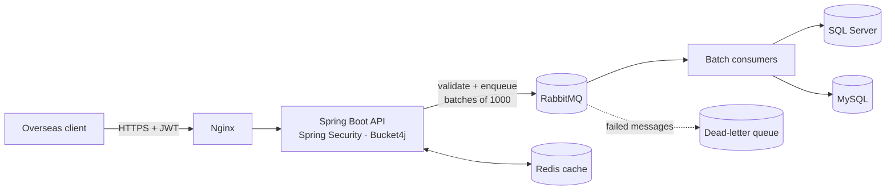
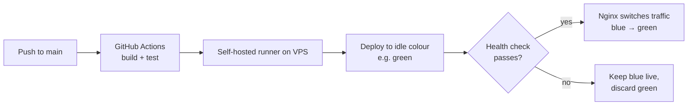

# Product Sync Platform — Architecture Case Study

> A production REST platform that ingests **500K+ chemical product records** from overseas clients into a dual-database backend, built with Spring Boot, RabbitMQ, Redis and zero-downtime Blue-Green deployments.

**Note:** This system runs in production at my current employer. The source code is proprietary, so this repository documents the **architecture, design decisions and trade-offs** only. No company code, data, credentials or client names are included.

<!-- Replace every [bracketed] value with a number you measured. Remove any line describing something you have not implemented. -->

---

## The problem

Overseas clients needed to push large product catalogues (500K+ records, with specs, pack sizes and pricing) into our systems. The original approach of synchronous inserts had three problems:

- Large uploads timed out and failed halfway, leaving partial data.
- Bulk writes slowed down the database for everyone else.
- Every deployment caused downtime for clients mid-sync.

## The solution at a glance

1. The client authenticates with a JWT and sends product data.
2. The API validates the payload, rate-limits per client and returns immediately with a job id.
3. Records are split into batches of 1000 and published to RabbitMQ.
4. Consumers write each batch to SQL Server and MySQL.
5. Read endpoints are served from Redis where possible.

## Key design decisions

| Decision | Why | Trade-off |
|---|---|---|
| **Async processing with RabbitMQ** | Uploads return in milliseconds instead of timing out; the database load is smoothed out | Clients must poll or be notified for completion |
| **Batches of 1000** | Balance between round trips and transaction size / memory. Chosen after testing [sizes tested] | Larger batches mean larger retries on failure |
| **RabbitMQ over Kafka** | Task-queue workload, no need for event replay or long retention; simpler to operate on one VPS | Not suited if we later need event streaming |
| **Dual datasource (SQL Server + MySQL)** | SQL Server holds the ERP-facing data; MySQL serves the web layer | Keeping both consistent: see below |
| **Redis caching** | Frequently read product data served without hitting the database | Cache invalidation on every update |
| **Bucket4j rate limiting** | Protects the platform from a single client flooding it | Limits must be tuned per client |

## Reliability

<!-- Keep only what is actually implemented. -->

- **Idempotent consumers:** each record is upserted by a unique business key, so a redelivered batch never creates duplicates.
- **Manual acknowledgment:** a batch is acknowledged only after both database writes succeed.
- **Retries + dead-letter queue:** failed batches are retried [N] times with backoff, then moved to a DLQ for inspection.
- **Consistency between databases:** [describe your approach, e.g. write to SQL Server first, then MySQL; a failure in the second write sends the batch to retry and the upsert makes it safe to repeat].

## Deployment: Blue-Green with zero downtime

- The new version is deployed alongside the live one and health-checked before Nginx switches traffic.
- Rollback is instant: point Nginx back at the previous colour.
- Database changes are backward compatible (expand first, contract in a later release), so both versions can run against the same schema.

## Results

| Metric | Before | After |
|---|---|---|
| Full sync time for 500K records | [X] | [Y] |
| Upload API response time | [X] | [Y] |
| p95 read latency (with Redis) | [X] ms | [Y] ms |
| Downtime per deployment | [X] | zero |
| Releases shipped with Blue-Green | — | [N] |

## Tech stack

Java · Spring Boot · Spring Security (JWT) · Spring Data JPA / Hibernate · RabbitMQ · Redis · SQL Server · MySQL · Bucket4j · Swagger / OpenAPI · Docker · Nginx · GitHub Actions

## What I would improve next

- Push completion notifications (webhook) instead of client polling.
- Metrics dashboard (Micrometer + Grafana) for queue depth and consumer lag.
- [Your own honest answer]
