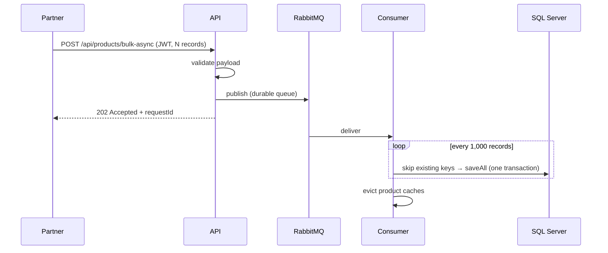
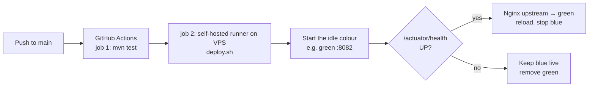

# Product Sync Platform

> A secured, rate-limited Spring Boot REST API that lets our China partner team upload **500K+ chemical product records** into the SQL Server ERP database that feeds SAP stock reconciliation. Large imports run asynchronously through **RabbitMQ in 1,000-record batches**, reads are cached in **Redis**, the contract is published with **OpenAPI / Swagger UI**, and releases ship with **zero-downtime blue-green deploys**.

**Stack:** Java 17 · Spring Boot 3 · Spring Security (JWT) · Spring Data JPA / Hibernate · JdbcTemplate · SQL Server (multiple datasources) · RabbitMQ · Redis · Bucket4j · springdoc OpenAPI · Docker · Nginx · GitHub Actions · JUnit 5 · Mockito · MockMvc

> **Note:** this system runs in production at my employer. The code is proprietary, so this repo documents the architecture, decisions and trade-offs only. It contains no company code, data, credentials or client names.

---

## The 30-second pitch

> "Our China partner's product, price and stock data used to arrive as Excel sheets by email and was imported by hand, so SAP and our stock reports were always out of sync. I built a REST API they integrate with directly: JWT auth, per-client rate limits, full CRUD, and an **async bulk endpoint** that returns **202** straight away and processes the upload through RabbitMQ in 1,000-record batches. I shared the **Swagger** docs so their team could test and integrate on their own. Reads are cached in Redis, and GitHub Actions does a health-checked blue-green deploy behind Nginx. Stock-mismatch reports against SAP now come straight from this data."

**Numbers to keep consistent:** about **125K live catalogue rows**; **500K+ records processed** across full and partial imports.

---

## Architecture

```mermaid
flowchart LR
    C[China partner<br/>API client] -->|HTTPS| CF[Cloudflare]
    CF --> NG[Nginx<br/>TLS, blue/green upstream]
    NG -->|blue :8081 / green :8082| RL[RateLimitFilter<br/>Bucket4j → 429]
    RL --> JW[JwtFilter → 401] --> CT[Controllers<br/>@Valid DTOs] --> SV[Services<br/>@Transactional, @Cacheable]
    SV <--> R[(Redis<br/>list 5 min, item 10 min)]
    SV -->|bulk-async| MQ[(RabbitMQ<br/>products.bulk.queue)]
    MQ --> CON[BulkProductConsumer<br/>batches of 1,000]
    CON --> DB[(SQL Server<br/>partner catalogue)]
    SV --> DB
    SV -->|JdbcTemplate, read-only| SAP[(SAP DB)]
    DB --> REP[SAP stock<br/>reconciliation reports]
```

### Async bulk import flow



---

## Components

| Component | What it does |
|---|---|
| **Auth** | API users log in with username + password (BCrypt) and get a **JWT** (HS512, role claim, about 24 h). A deactivated user is blocked even with a valid token (an `is_active` check per request gives revocation back to a stateless design). |
| **Rate limiting** | **Bucket4j** token bucket (about 100/min per client, plus an hourly cap). Returns `429` with `X-Rate-Limit-Remaining`. |
| **Catalogue CRUD** | Create, get, paginated keyword search, `PUT` (full) / `PATCH` (non-null fields only), **soft delete** + `/reactivate` (409 if already active). The business key is the pack-size code, so a duplicate returns `409`. |
| **Bulk endpoints** | `/bulk` (sync, small lists) and `/bulk-async` (**202 + requestId**, RabbitMQ, 1,000-record batches, duplicates skipped and counted). |
| **Caching** | Redis cache-aside: paginated list 5 min, single product 10 min, evict on every write. JSON serializer with `JavaTimeModule`; DTOs are cached, not entities. |
| **Multiple datasources** | Separate `DataSource` + `EntityManagerFactory` + `TransactionManager` per database; writes use the qualified transaction manager. |
| **Partner search API** | Read-only search over live SAP item, price and warehouse tables by CAS, catalogue no., name or SMILES (JdbcTemplate, because SAP's schema isn't ours to map as entities). |
| **API docs** | **springdoc OpenAPI + Swagger UI**, shared with the partner team so they could test endpoints and integrate without back-and-forth. |
| **Errors** | A module-scoped `@ControllerAdvice` (`basePackages`, `@Order(1)`) so this API's error JSON doesn't clash with the dashboard's global handler. |

---

## Deployment: blue-green with zero downtime



- Rollback is instant: point Nginx back at the old colour.
- Schema changes must be **backward compatible** (expand, then contract later), because both colours briefly use the same database.

---

## Design decisions and trade-offs

| Decision | Alternative | Why |
|---|---|---|
| **RabbitMQ for bulk** | sync bulk, `@Async`, Kafka, Spring Batch | Sync times out on big lists. `@Async` loses work on restart. A durable queue survives restarts. Kafka is overkill for one producer, one consumer and no replay. |
| **JWT + `is_active` check** | sessions, API keys, OAuth2 client-credentials | Machine clients, nothing stored on the server; one DB lookup per request buys revocation |
| **Soft delete** | hard delete | Products are referenced by SAP reports, and partners delete by mistake |
| **Cache-aside + evict-all on write** | fine-grained eviction | Simple and always correct; writes are rare compared with reads |
| **In-memory Bucket4j** | Redis-backed buckets, Nginx `limit_req` | Only one live instance (blue-green); move to Redis once there are several |
| **Blue-green** | rolling, canary | Instant rollback with only two containers on one VPS |

---

## Testing

- **Service tests (Mockito):** create, duplicate → exception, not found → 404, `PATCH` copies only non-nulls, soft delete, reactivate-when-active → 409.
- **Controller tests (MockMvc + mocked service):** status codes 201 / 200 / 400 / 404 / 409 and the JSON shape.
- **Auth tests:** correct password → token; wrong password or inactive user → rejected.
- Tests run on **H2**, so CI needs no SQL Server, Redis or RabbitMQ. The pipeline won't deploy if a test fails.

---

## Interview questions on this project

**Q: How would you scale it 10x?**
Run several app instances behind an Nginx upstream (JWT is already stateless), move the rate-limit buckets to **Redis**, and cache the `is_active` user check. For bigger imports: several consumers with prefetch, one transaction per chunk, a **set-based duplicate check** (`WHERE key IN (...)` per chunk instead of 1,000 `exists` calls), and JDBC batching or SQL Server bulk copy. For search: `LIKE '%x%'` can't use an index, so use prefix search on CAS / catalogue no., a full-text index, or OpenSearch. For deep pages, use **keyset pagination** instead of `OFFSET`.

**Q: What was the biggest problem you faced?**
**Bulk uploads timed out.** The partner sent very large lists to the sync endpoint; it ran for minutes and Nginx and Cloudflare cut it off halfway. I added `/bulk-async`: validate, publish to a durable RabbitMQ queue, return **202 + requestId**, and a consumer inserts in 1,000-record batches, skipping existing keys. Uploads now return in milliseconds and the DB load is smoothed out.

**Q: Another tricky bug?**
- **Three datasources:** a `@Transactional` without a qualifier used the *primary* (SAP) transaction manager, so writes to the partner table weren't really transactional. **Fix:** a qualified transaction manager on every write, including the consumer.
- **Rate limiter bug I found later:** the bucket key was the first 20 characters of the JWT, but every HS512 token starts with the same header (`eyJhbGciOiJIUzUxMiJ9`). So all clients shared **one** bucket. **Fix:** key by the authenticated username, after the JWT filter.
- **Real client IP behind Cloudflare + Nginx** was always `127.0.0.1`. **Fix:** forward `X-Forwarded-For` and set `server.forward-headers-strategy=native`.

**Q: What happens if a batch fails halfway?**
Each 1,000-record batch is one transaction, so it rolls back as a whole. Duplicates are skipped by business key, so re-processing a batch is **idempotent**. Next steps: retries with a **dead-letter queue** and a status endpoint for `requestId`.

**Q: Why RabbitMQ and not Kafka?**
This is a task queue: one producer, one consumer, delete after processing, no need to replay. RabbitMQ gives acks, retries and a DLQ with less to run. Kafka fits event streams with many consumers and replay.

**Q: What would you improve?**
A job-status endpoint or webhook instead of fire-and-forget; DLQ and retry metrics; Micrometer + Grafana for queue depth; OAuth2 client-credentials instead of username/password for machine clients.
