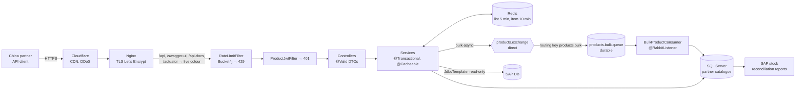
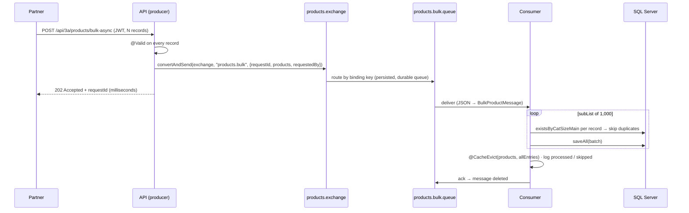
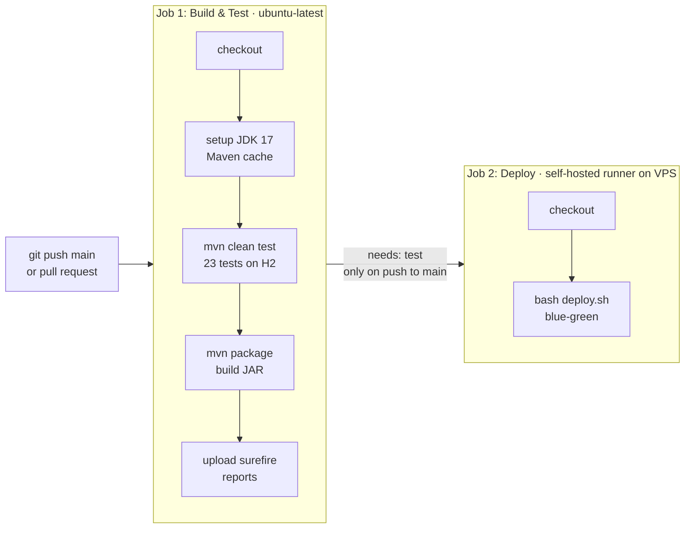
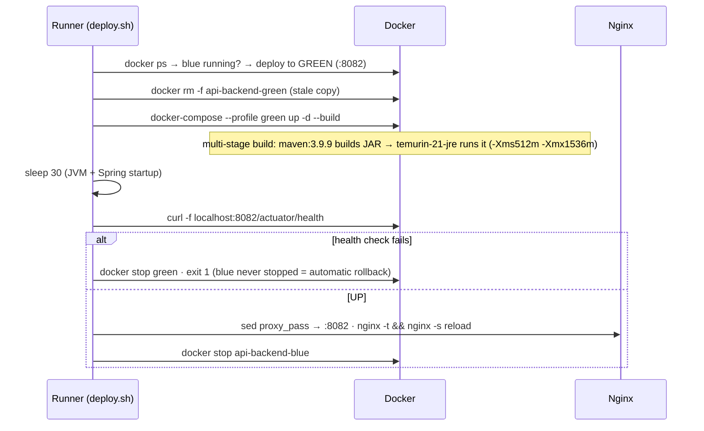

# Product Sync Platform

> A secured, rate-limited Spring Boot REST API that lets our China partner team upload **500K+ chemical product records** into the SQL Server ERP database that feeds SAP stock reconciliation. Large imports run asynchronously through **RabbitMQ in 1,000-record batches**, reads are cached in **Redis**, the contract is hosted as **Swagger UI**, and every push goes through a **GitHub Actions pipeline: tests first, then a zero-downtime blue-green deploy**.

**Stack:** Java 17 · Spring Boot 3 · Spring Security (JWT) · Spring Data JPA / Hibernate · JdbcTemplate · SQL Server (multiple datasources) · RabbitMQ · Redis · Bucket4j · springdoc OpenAPI · Docker (multi-stage) · Nginx · GitHub Actions (self-hosted runner) · JUnit 5 · Mockito · MockMvc · H2

> **Note:** this system runs in production at my employer. The code is proprietary, so this repo documents the architecture, decisions and trade-offs only. It contains no company code, data, credentials or client names.

---

## The 30-second pitch

> "Our China partner's product, price and stock data used to arrive as Excel sheets by email and was imported by hand, so SAP and our stock reports were always out of sync. I built a REST API they integrate with directly: JWT auth, per-client rate limits, full CRUD, and an **async bulk endpoint** that returns **202** straight away and processes the upload through RabbitMQ in 1,000-record batches. I hosted **Swagger UI** so their team could authorise with a token and try every endpoint themselves. Every push runs the test suite in GitHub Actions, and only if it passes does a self-hosted runner do a **blue-green Docker deploy** behind Nginx with a health check and automatic rollback."

**Numbers to keep consistent:** about **125K live catalogue rows**; **500K+ records processed** across full and partial imports; **23 automated tests** gate every deploy.

---

## Architecture



### Request flow: `GET /api/3a/products?keyword=acid&page=0&size=20`

1. Cloudflare → Nginx (TLS terminated) → the **live** container (blue `:8081` or green `:8082`). `server.forward-headers-strategy=native` keeps the real client IP and `https` scheme.
2. **RateLimitFilter** (only `/api/3a/**`, skips login + health) takes a token from the client's Bucket4j bucket. If it's empty: `429` + `X-Rate-Limit-Remaining`.
3. **ProductJwtFilter** (`OncePerRequestFilter`) verifies the signature and expiry, extracts the username, and checks the user is still **active in the DB**. Any failure: `401` JSON.
4. `@Cacheable("products", key = keyword_page_size)`: on a hit, return from Redis; on a miss, a JPQL `LIKE` search across name / catalogue no. / CAS / pack code with a `Pageable`, then cache it.
5. Entities are mapped to DTOs → `{ data, page, size, totalItems, totalPages }`.

---

## Bulk insert in detail (the part interviewers drill into)

### Why async?
A partner once sent a very large list to the synchronous `/bulk` endpoint. It ran for minutes, then **Nginx and Cloudflare timed out** the request halfway through: partial data, and the client didn't know what was saved. The fix was to **stop doing the work inside the HTTP request**.



**Step by step:**
1. **Producer** (`BulkProductProducer`): creates a `requestId` (UUID) and publishes **one message** `{requestId, products, requestedBy, requestedAt}` to the **direct exchange** `products.exchange` with routing key `products.bulk`. `Jackson2JsonMessageConverter` serialises it as JSON.
2. The API returns **`202 Accepted` + requestId** at once; the HTTP thread is free.
3. **Consumer** (`@RabbitListener` on `products.bulk.queue`) receives it and walks the list in **`subList`s of 1,000**.
4. For each record, it **skips existing business keys** (`catSizeMain`, the pack-size code) and counts them, so a **re-sent file is idempotent**: no duplicates.
5. `saveAll()` per 1,000-record chunk keeps memory and round trips bounded.
6. The listener is `@Transactional("testDensityTransactionManager")`, so the whole message commits **or rolls back as one unit**, and `@CacheEvict(allEntries = true)` clears the product cache so readers see the new data.
7. On success the listener returns normally → Spring AMQP **acks** → RabbitMQ deletes the message.

**Why 1,000?** It balances round trips against transaction size and memory. Smaller means more DB calls; much larger means big memory spikes and long rollbacks.

### RabbitMQ internals you should be able to explain

```
Producer ──► Exchange ──(binding: routing key)──► Queue ──► Consumer
             "products.exchange"  "products.bulk"   "products.bulk.queue"
             type = DIRECT                           durable = true
```

| Concept | What it means here |
|---|---|
| **Exchange** | Producers never write to a queue directly; they publish to an exchange, which routes. |
| **Direct exchange** | Routes a message to queues whose **binding key equals the routing key** (`products.bulk`). Others: **fanout** (every bound queue), **topic** (pattern match `products.*`), **headers**. |
| **Binding** | The rule linking exchange → queue (`BindingBuilder.bind(queue).to(exchange).with("products.bulk")`). |
| **Durable queue** | The queue definition survives a broker restart. Messages also survive if they're published as **persistent** (Spring's default delivery mode). |
| **Ack** | The broker deletes a message only after the consumer **acknowledges** it. Spring's default `AUTO` mode acks when the listener returns and **nacks** if it throws. |
| **Prefetch** | How many unacked messages one consumer may hold (Spring default 250). With large messages, a lower prefetch spreads work across consumers. |
| **Competing consumers** | Several consumers on one queue share the messages; each message goes to exactly one of them. This is how you scale workers. |
| **Dead-letter exchange (DLX)** | Where a rejected or expired message goes instead of being lost or retried forever. |
| **Connection vs channel** | One TCP connection per app, with many lightweight **channels** multiplexed on it. |

**Known gap (say it before they find it):** if the listener throws, Spring by default **requeues** the message, so a "poison" message (e.g. a malformed record) is redelivered in a loop. **Fix:** bounded retries (`spring.rabbitmq.listener.simple.retry.enabled=true`, max 3 attempts with backoff) plus `default-requeue-rejected=false` and a **DLX → `products.bulk.dlq`** to inspect failures. Next improvements: **one transaction per chunk** (so a bad record at row 90,000 doesn't roll back 89,000 good ones), a **set-based duplicate check** (`WHERE catSizeMain IN (:keys)` once per chunk instead of 1,000 `exists` calls), and a `GET /bulk/{requestId}` status endpoint.

---

## Swagger UI: how it's hosted for the partner

- **springdoc-openapi** generates the OpenAPI spec from the controllers and `@Valid` DTOs, so the docs can't drift from the code.
- `SwaggerConfig` registers a **Bearer JWT security scheme**, so Swagger UI shows an **Authorize** button: the partner calls `/login`, pastes the token, and can **try every endpoint live**.
- `springdoc.paths-to-match=/api/3a/**` publishes **only the partner API**, not internal dashboard endpoints.
- Paths: spec at `/api-docs`, UI at `/swagger-ui/index.html`. **Nginx** proxies `/swagger-ui`, `/v3` and `/api-docs` to the live container over **HTTPS**, so the partner uses one public URL.
- Result: the partner team integrated on their own, without back-and-forth emails about field names or error codes.

---

## CI/CD: tests must pass before anything deploys



- **Pull requests** run Job 1 only, so a broken change is caught before merge.
- **Job 2 has `needs: test`**: if any test fails, the deploy job never starts. Production only gets code that passed.
- Tests use an **H2 in-memory** profile, so the pipeline needs no SQL Server, Redis or RabbitMQ.
- Test reports are uploaded as an artifact **even on failure** (`if: always()`), so you can see which test broke.
- The deploy job runs on a **self-hosted runner** on the VPS, so no SSH keys or server credentials are stored in GitHub.

### What the 23 tests cover

| Test class | Style | Checks |
|---|---|---|
| `ChemProductServiceTest` | Mockito | create OK; duplicate → `ChemProductAlreadyExistsException`; not found → 404; `PATCH` copies only non-null fields; soft delete; reactivate when already active → 409 |
| `ChemProductControllerTest` | MockMvc + mocked service | status codes 201 / 200 / 400 (validation) / 404 / 409 and JSON shape |
| `ProductAuthServiceTest` | Mockito | correct password → token; wrong password or **inactive user** → rejected |

---

## Blue-green deployment in detail

**Idea:** two identical containers, **blue (`:8081`)** and **green (`:8082`)**. Only one is live behind Nginx. You deploy to the idle one, test it, then switch traffic in one step.



**Why it's zero-downtime:** `nginx -s reload` is **graceful**: new worker processes take new connections on the new port, while old workers finish their in-flight requests and then exit. No request is dropped.

**Why the rollback is automatic:** the old colour keeps serving until the new one is proven healthy. If the health check fails, nothing switched. If a problem appears *after* the switch, rolling back means pointing Nginx at the old port again; the old image is still there.

**The multi-stage Dockerfile:**
- **Stage 1** (`maven:3.9.9-eclipse-temurin-21`): copies `pom.xml` first and runs `dependency:go-offline`, so **dependencies are a cached layer** and only change when the pom changes. Then it copies the source and builds the JAR.
- **Stage 2** (`eclipse-temurin:21-jre`): copies only the JAR. The image is small, with no Maven or source code inside.

**Rules this forces on you:**
- **DB changes must be backward compatible** (expand → migrate → contract), because during the switch both versions use the same database.
- Double memory is needed during a deploy (two JVMs).
- **Improvement:** `sleep 30` is a guess; a retry loop on `/actuator/health` (or a `readiness` group) is more robust. I'd also define an Nginx **`upstream`** block, so the switch is one line instead of a `sed` on every `location`.

---

## Components

| Component | What it does |
|---|---|
| **Auth** | API users log in (BCrypt, `api_users` table) → **JWT** (HS512, role claim, about 24 h). Inactive users are blocked even with a valid token. |
| **Rate limiting** | Bucket4j token bucket (about 100/min per client + an hourly cap) → `429` |
| **Catalogue CRUD** | Create, get, paginated search, `PUT` / `PATCH`, **soft delete** + `/reactivate`, business-key duplicates → `409` |
| **Bulk** | `/bulk` (sync, small lists), `/bulk-async` (RabbitMQ, 202 + requestId) |
| **Caching** | Redis cache-aside; `GenericJackson2JsonRedisSerializer` + `JavaTimeModule`; DTOs cached, not entities |
| **Multiple datasources** | One `DataSource` + `EntityManagerFactory` + `TransactionManager` per database; writes use the qualified manager |
| **Partner search** | Read-only search over SAP item, price and stock tables by CAS / catalogue no. / name / SMILES (JdbcTemplate) |
| **Errors** | A module-scoped `@ControllerAdvice` (`basePackages`, `@Order(1)`), separate from the dashboard's global handler |

---

## Interview questions on this project

**Q: How would you scale it 10x?**
More API instances behind an Nginx `upstream` (JWT is stateless); rate-limit buckets in **Redis** (`bucket4j-redis`); cache the `is_active` check. For imports: **competing consumers** (`concurrency=3-5`, lower prefetch), a transaction per chunk, a set-based duplicate check, JDBC batching / SQL Server bulk copy. For search: prefix search on indexed columns, full-text index, or OpenSearch. For deep pages, use **keyset pagination**.

**Q: Biggest problem you faced?**
Bulk uploads timing out halfway through (above). The async redesign with RabbitMQ + 202 + idempotent batches fixed it.

**Q: Other tricky bugs?**
- **Wrong transaction manager:** with three datasources, a plain `@Transactional` used the *primary* (SAP) manager, so partner-table writes weren't really transactional. Fix: qualify it on every write, including the consumer.
- **Rate limiter shared by everyone:** the bucket key was the first 20 characters of the JWT, but every HS512 token starts with the same header (`eyJhbGciOiJIUzUxMiJ9`). Fix: key by the authenticated username, after the JWT filter.
- **Client IP was `127.0.0.1`** behind Cloudflare + Nginx. Fix: forward `X-Forwarded-For` + `forward-headers-strategy=native`.
- **Redis serialization** failed on `LocalDateTime` / `Page`. Fix: Jackson serializer with `JavaTimeModule`, cache DTOs.

**Q: What if RabbitMQ is down when the partner uploads?**
`convertAndSend` throws → the API returns an error instead of 202, so the partner knows to retry. Nothing is half-saved. For stronger guarantees: **publisher confirms** (the broker acks the publish), or an **outbox table** written in the same DB transaction and relayed to RabbitMQ.

**Q: Why RabbitMQ, not Kafka?**
It's a task queue: one producer, one consumer, delete after processing, no replay. RabbitMQ gives routing, acks, retries and DLQ with less to operate. Kafka is a retained log for many consumers and replay, which isn't needed here.

**Q: Blue-green vs rolling vs canary?**
Blue-green: instant switch and rollback, needs 2× resources briefly. Rolling: replaces instances one by one, with no spare capacity needed but mixed versions for a while. Canary: send a small % of traffic to the new version first. With one VPS and two containers, blue-green was the simplest safe choice.
